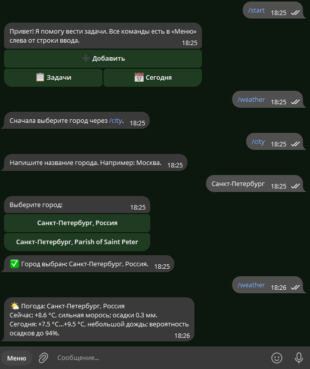
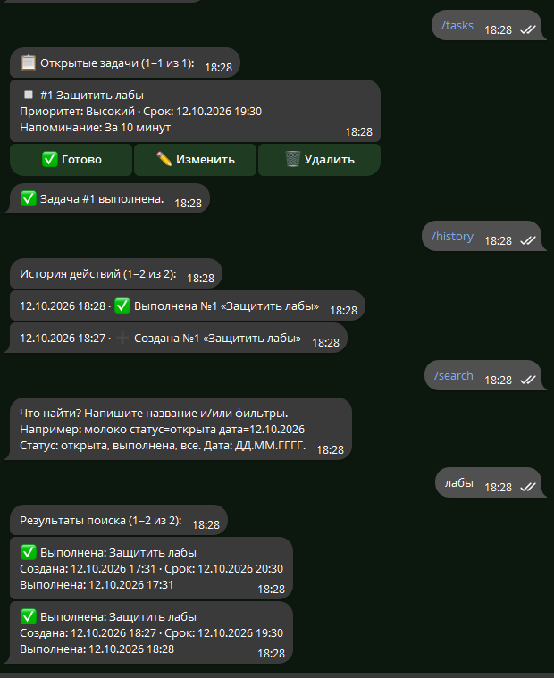

# Отчёт по лабораторной работе: интеграция данных в Telegram-бота

**Проект:** бот личных задач на Python  
**Дата:** 12.10.2026  
**Исходный проект:** [бот для задач](bot.py), [инструкция по запуску](README.md)  
**Результат:** получение погоды из Open-Meteo и хранение задач, профилей и истории действий в SQLite.

| Результат лабораторной | Состояние и подтверждение |
| --- | --- |
| Бот работает с источником данных | Показаны выбор города и ответ `/weather` на скриншоте; обработка JSON проверена тестами. |
| Данные корректно обрабатываются и отображаются | Проверены погодные поля, русский текст, поиск и история; примеры приведены ниже. |
| Промпт для LLM сохранён | Исходный запрос, итерации и сводный промпт приведены в разделе 2. |
| Видео-демо | Сценарий подготовлен; ссылка ожидает записи видео. |
| Отчёт | Этот файл содержит описание, код, тестирование, трудности и выводы. |

## 1. Описание интеграции

### Какой источник данных выбран

Внешний источник — [Open-Meteo Weather Forecast API](https://open-meteo.com/en/docs). Для перевода названия города в координаты используется [Open-Meteo Geocoding API](https://open-meteo.com/en/docs/geocoding-api). Оба сервиса возвращают JSON; для некоммерческого сценария проекта ключ API не требуется. Локальный источник данных — файл SQLite `tasks.db`, в котором бот хранит задачи и настройки каждого пользователя.

### Почему выбран именно он

Погода помогает планировать дела на сегодня: рядом с задачами пользователь видит текущую температуру, погодные условия и вероятность осадков. Open-Meteo позволяет искать город по названию и получать прогноз по координатам без регистрации ключа для учебного некоммерческого проекта. SQLite уже использовалась ботом, поэтому новые таблицы добавлены без отдельного сервера и без потери существующих задач.

### Структура данных

| Источник | Важные поля | Использование |
| --- | --- | --- |
| Geocoding API, объект `results[]` | `name`, `country`, `admin1`, `latitude`, `longitude` | Показ вариантов города; сохранение выбранного города и координат. |
| Forecast API, объект `current` | `temperature_2m`, `weather_code`, `precipitation` | Температура, описание погоды и количество осадков за текущий интервал. |
| Forecast API, объект `daily` | `temperature_2m_min[]`, `temperature_2m_max[]`, `weather_code[]`, `precipitation_probability_max[]` | Краткий прогноз на сегодняшний день. Берётся первый элемент каждого массива. |
| SQLite, таблицы `tasks`, `user_locations` | ID владельца, задачи, статусы, сроки; город и координаты | Постоянное хранение личных данных бота. |
| SQLite, таблицы `users`, `interactions`, `task_history` | Профиль пользователя; тип и время обращения; снимки действий с задачами | История, поиск и разделение данных пользователей. |

Код `weather_code` приходит числом и преобразуется в русский текст по таблице WMO из [документации Open-Meteo](https://open-meteo.com/en/docs). Например, код `3` отображается как «пасмурно», а `61` — «небольшой дождь». Значения времени задач хранятся в UTC и отображаются по `TIMEZONE` из `.env`; прогноз на сегодня запрашивается с `timezone=auto` для выбранного города.

Ниже пример **тестового** JSON, используемого в [test_weather.py](test_weather.py). Он показывает форму ответа, с которой работает парсер, и не выдаётся за сохранённый ответ живого API:

```json
{
  "current": {
    "temperature_2m": 12.5,
    "weather_code": 3,
    "precipitation": 0.2
  },
  "daily": {
    "temperature_2m_min": [8.0],
    "temperature_2m_max": [17.0],
    "precipitation_probability_max": [60],
    "weather_code": [61]
  }
}
```

## 2. Промпт для LLM

### Исходный промпт

Исходный запрос на интеграцию погоды из истории разработки; служебные переносы и повторяющиеся пункты сгруппированы для чтения:

> Улучши моего Telegram-бота, добавив работу с `[тип данных]`.
>
> Текущий функционал бота: бот помогает вести личный список задач в Telegram: добавлять, изменять, выполнять и удалять дела, задавать приоритет, срок и напоминание. Команды доступны через кнопку «Меню». «Задачи» показывает все открытые дела по номерам. «Сегодня» показывает задачи со сроком сегодня или раньше, а также задачи без срока, созданные сегодня. Выполненные дела учитываются в статистике, а открытые задачи после выполнения или удаления перенумеровываются с №1. Данные сохраняются в SQLite.
>
> Новый функционал: добавить получение актуальной погоды и прогноза на сегодня через бесплатный API Open-Meteo. Получать данные в формате JSON, показывать температуру, погодные условия и вероятность осадков. Добавить краткий прогноз в раздел «Сегодня». Добавить команды `/city` для выбора города и `/weather` для просмотра погоды.
>
> Данные: API погоды — https://open-meteo.com/en/docs; API поиска городов — https://open-meteo.com/en/docs/geocoding-api. Использовать данные о температуре, осадках, погодных условиях и координатах города. Сохранять выбранный пользователем город и его координаты в SQLite. API не требует ключа для некоммерческого использования.
>
> Данные: `[Опишите структуру данных или дайте ссылку на API]`.
>
> Требования: код должен быть простым и понятным; добавить обработку ошибок; хорошие комментарии в коде; сохранить существующий функционал. Создай обновлённый `bot.py`, файл с данными при необходимости и обновлённый `README.md`.

### Итерации и улучшения

| Этап | Уточнение или проверка | Результат |
| --- | --- | --- |
| Основа проекта | Бот задач уже работал с SQLite, постоянным «Меню» и корректной нумерацией открытых задач. | Сохранён существующий сценарий задач. Его первоначальный промпт описан в [предыдущем отчёте](REPORT.md). |
| Уточнение промпта | В исходном шаблоне остались поля `[тип данных]` и `[Опишите структуру данных или дайте ссылку на API]`. | В сводном промпте явно указаны погодный JSON, поля ответа и два API Open-Meteo. |
| Интеграция Open-Meteo | Нужны выбор города и актуальная погода в JSON. | Добавлены `/city`, `/weather`, сохранение координат, перевод погодных кодов и прогноз в «Сегодня». |
| Обработка ошибок | Город может не находиться; API может вернуть ошибку или неполный JSON. | Добавлены понятные сообщения и исключение `WeatherError`; список задач продолжает работать при сбое погоды. |
| Хранение истории | Дополнительный запрос потребовал данные пользователей, историю изменений, поиск и недельный список. | Добавлены таблицы `users`, `interactions`, `task_history` и команды `/history`, `/search`, `/week`. |
| Проверка результата | Проверены реальные сообщения Telegram и локальные автоматические тесты. | В отчёт добавлены предоставленные скриншоты; тесты проверяют JSON, SQLite, поиск, историю и изоляцию пользователей. |

### Финальный промпт

Это **сводная формулировка** требований для воспроизведения результата. В разработке функции добавлялись последовательными запросами, а не одним таким сообщением:

> Доработай существующего Telegram-бота задач на Python (`python-telegram-bot`), не меняя его основную логику. Через Open-Meteo Geocoding API ищи город по названию, предлагай выбор при нескольких совпадениях и сохраняй город с координатами отдельно для каждого пользователя в SQLite. Через Open-Meteo Forecast API получай JSON с текущей температурой, осадками, кодом погоды, дневными минимумом и максимумом температуры и максимальной вероятностью осадков. Реализуй `/city`, `/weather` и краткий прогноз в `/today`, включая день без задач. Переводи погодные коды на русский язык, обрабатывай сетевые ошибки и неполные ответы.
>
> Сохраняй профиль пользователя и метаданные обращений в SQLite. Журналируй создание, изменение, выполнение и удаление задач в одной транзакции с действием; сохраняй историю даже после удаления задачи. Добавь `/history`, `/search` по названию, статусу и дате, а также `/week` для задач, созданных за семь календарных дней. Все запросы ограничивай ID пользователя. Обнови инструкции, добавь проверки и сохрани команды в постоянном «Меню» Telegram.

## 3. Реализация

### Как работает интеграция

1. `/city` получает название города и запрашивает до пяти вариантов в Geocoding API. Если вариантов несколько, бот показывает кнопки выбора.
2. Выбранные название, страна, широта и долгота записываются в `user_locations` по Telegram ID пользователя.
3. `/weather` читает координаты из SQLite, отправляет запрос в Forecast API с `current`, `daily`, `timezone=auto` и `forecast_days=1`, затем форматирует ответ на русском языке.
4. `/today` дополнительно показывает короткую сводку погоды. Если API недоступен, бот сообщает об этом и всё равно выводит задачи.
5. Действия с задачами записываются в `task_history` вместе с самой операцией SQLite. `/history` показывает эти записи, включая удалённые задачи. `/search` фильтрует существующие задачи по названию, статусу и дате; `/week` показывает созданные сегодня и за шесть предыдущих календарных дней задачи.

### Ключевые фрагменты кода

Запрос прогноза в [bot.py](bot.py) использует сохранённые координаты:

```python
data = await fetch_json(
    FORECAST_URL,
    {
        "latitude": location["latitude"], "longitude": location["longitude"],
        "current": "temperature_2m,precipitation,weather_code",
        "daily": "temperature_2m_max,temperature_2m_min,precipitation_probability_max,weather_code",
        "timezone": "auto", "forecast_days": 1,
    },
)
```

Сеть и формат JSON проверяются отдельно: `fetch_json()` ограничивает ожидание десятью секундами, вызывает `raise_for_status()`, затем `response.json()`; ошибки HTTP, сети и декодирования превращаются в понятное сообщение. `weather_text()` дополнительно проверяет наличие нужных полей и переводит `weather_code` через `WEATHER_CODES`.

Журнал действия записывается через `record_task_action(db, ...)` **в том же соединении и транзакции**, в которых меняется задача. Это сохраняет название и номер на момент действия даже после удаления строки из `tasks`. Поиск сначала ограничивает выборку `user_id`, затем сравнивает русские названия без учёта регистра (`casefold`) и проверяет даты по часовому поясу пользователя.

### Используемые библиотеки

| Библиотека | Назначение |
| --- | --- |
| `python-telegram-bot[job-queue]==22.8` | Команды, сообщения, кнопки, меню Telegram и напоминания. |
| `httpx` | Асинхронные HTTP-запросы к Open-Meteo с тайм-аутом. |
| `sqlite3` | Локальное постоянное хранение задач, городов, профилей и журналов. |
| `python-dotenv` | Загрузка токена и настроек из `.env`. |
| `zoneinfo`, `tzdata` | Корректная обработка дат и часовых поясов. |
| `unittest` | Автоматические проверки без реальных запросов к внешнему API. |

`sqlite3`, `zoneinfo` и `unittest` входят в стандартную библиотеку Python; остальные зависимости перечислены в [requirements.txt](requirements.txt).

## 4. Тестирование

### Скриншоты работы

**Выбор города и ответ `/weather`.** На скриншоте видны сообщение об отсутствии выбранного города, варианты поиска Санкт-Петербурга и фактический ответ бота с температурой, условиями и осадками.



**История и поиск.** На скриншоте видны выполненная задача, записи `/history` о создании и выполнении, а также результаты `/search` по названию.



При необходимости сюда можно добавить отдельный скриншот `/today` с кратким прогнозом и `/week` с недельным списком.

### Примеры запросов и ответов

| Запрос | Наблюдаемый или ожидаемый ответ |
| --- | --- |
| `/weather` до выбора города | «Сначала выберите город через /city.» — видно на первом скриншоте. |
| `/city`, затем `Санкт-Петербург` | Список найденных вариантов и подтверждение «Город выбран: Санкт-Петербург, Россия.» — видно на первом скриншоте. |
| `/weather` после выбора | «Сейчас: +8.6 °C, сильная морось; осадки 0.3 мм. Сегодня: +7.5 °C…+9.5 °C, небольшой дождь; вероятность осадков до 94%.» — пример с первого скриншота; значения меняются при каждом запросе. |
| `/history` | Записи о создании и выполнении задачи «Защитить лабы» — видно на втором скриншоте. |
| `/search`, затем `лабы` | Найдены две выполненные задачи с датами создания, срока и выполнения — видно на втором скриншоте. |
| `/search лабы статус=выполнена дата=12.10.2026` | Фильтрация по названию, статусу и дате; проверена автоматическим тестом. |
| `/week` | Задачи, созданные за семь календарных дней; проверено автоматическим тестом, отдельный скриншот пока не приложен. |

Локально выполнена команда `python -m unittest -v test_history_search test_weather`: **10 тестов прошли**. Проверены разбор тестового JSON, сохранение координат, погода при пустом списке задач, сообщение при повреждённом ответе, журнал после удаления, поиск по статусу и датам, недельный список, страницы результатов, сохранение старых задач при создании новых таблиц и разделение пользователей. Дополнительно прошли `py_compile` и `pip check`. Автоматические тесты подменяют HTTP-ответы; работа в интерфейсе Telegram показана приложенными скриншотами.

### Видео-демо

**Ссылка на видео (YouTube или Google Drive):** `[добавить ссылку после записи]`.

Сценарий записи: `/start` → `/city` и выбор города → `/weather` → `/today` → создание и выполнение задачи → `/history` → `/search` → `/week`. Видео-файл и ссылка к отчёту пока не приложены.

## 5. Трудности и решения

| Трудность | Решение |
| --- | --- |
| По одному названию может находиться несколько городов. | Показать до пяти вариантов с регионом и страной; сохранить координаты только после выбора кнопкой. |
| API возвращает числовые погодные коды, а пользователь ожидает русский текст. | Использовать словарь кодов WMO и короткие русские описания. |
| Сеть, HTTP-ошибка или неполный JSON могут сорвать ответ. | Тайм-аут, проверка HTTP-статуса и полей JSON, `WeatherError` и понятное уведомление; задачи остаются доступны. |
| После удаления строки задачи её история могла бы исчезнуть. | Сохранить снимок названия, номера и действия в отдельной таблице `task_history` в одной транзакции с удалением. |
| Выполненные задачи не имеют текущего видимого номера. | В поиске показывать статус и название; в истории хранить номер на момент действия. |
| Данные разных людей не должны смешиваться. | Сохранять `user_id` во всех таблицах и ограничивать им чтение и изменение записей. |
| Живые погодные значения меняются со временем. | Отделить пример из скриншота от фикстуры JSON и использовать повторяемые автоматические тесты. |

## 6. Выводы

### Что получилось хорошо

Бот сочетает внешний JSON-источник и локальную SQLite-базу: город сохраняется между запусками, погода кратко отображается в «Сегодня», а задачи продолжают работать при ошибке сервиса погоды. История действий сохраняется после удаления задач, поиск и недельный список учитывают владельца данных. Скриншоты показывают реальное использование `/weather`, `/history` и `/search` в Telegram.

### Что можно улучшить

Добавить отдельные скриншоты `/today` и `/week`, записать и вставить ссылку на видео-демонстрацию, а также провести автоматическую интеграционную проверку на тестовом Telegram-боте с живым ответом Open-Meteo. При большом числе задач поиск можно перенести из Python в индексируемые SQL-запросы.
